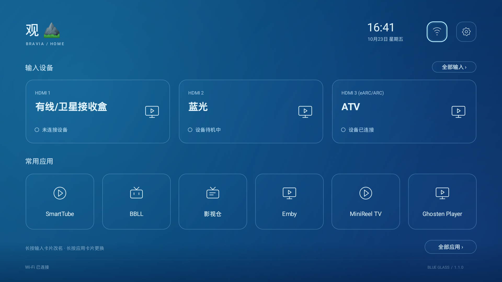
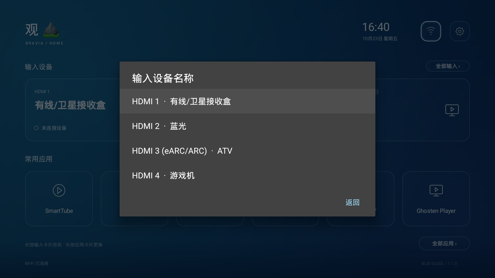
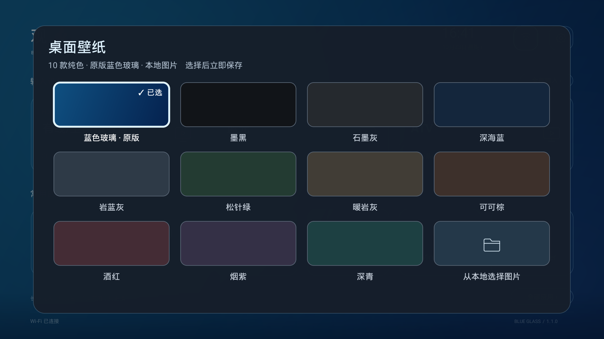
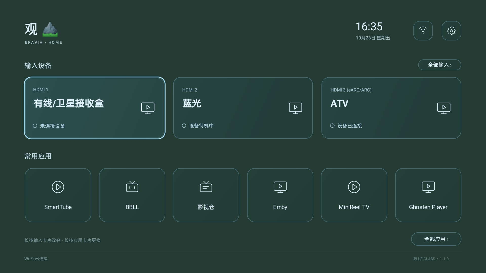

<div align="center">

# Blue Glass TV Launcher · Android TV 电视桌面

**让电视回到一个安静、清楚、好用的首页。**

Android TV 电视桌面 / TV Launcher · 蓝色玻璃与低饱和纯色 · 为遥控器设计


[](LICENSE)

[下载 APK](https://github.com/beer-on-ice/blue-glass-tv-launcher/releases/latest) · [功能与截图](#功能与截图) · [安装](#安装) · [编译源码](#编译源码)

</div>



Blue Glass TV Launcher（应用内名称 Blue Glass Home）是一款轻量的 Android TV 电视桌面：真实 HDMI 输入、六个常用应用、时钟和系统入口，集中在一屏。半透明卡片配合清晰的遥控器焦点，背景可以保留蓝色玻璃，也可以换成纯色或自己的图片。

界面采用 Java 原生 View 和矢量绘制，无第三方运行时依赖，无广告、推荐信息流、遥测或网络请求。v1.1.0 APK 约 34 KB。

## 功能与截图

### 真实输入，固定顺序

- 从电视系统读取 HDMI 与 CEC 设备，按物理端口编号排序，接拔设备不会把卡片重新打乱。
- 首页显示前三个 HDMI 端口；第四端口及其余 CEC 设备可从“全部输入”进入。
- **长按输入卡片即可改名**，例如 ATV、蓝光、游戏机；名称绑定物理端口，保存后持续生效。
- 齿轮 →“输入设备名称”可编辑所有端口，也可恢复系统名称。改名只影响本桌面。



### 蓝色玻璃、十款纯色、你的图片

齿轮 → **桌面壁纸**，用方向键选择，按确定立即保存。



| 色系 | 预设 |
| --- | --- |
| 深色中性 | 墨黑、石墨灰、暖岩灰 |
| 冷色 | 深海蓝、岩蓝灰、深青 |
| 自然与暖色 | 松针绿、可可棕、酒红、烟紫 |

纯色背景直接绘制为单一颜色，不叠加渐变。下面是松针绿的实机效果：



也可以通过系统或已安装的文件管理器选择本地图片。图片会居中裁剪、适度压暗，并保存一份应用内副本；删除原文件后仍能使用。已保存的图片可再次选用，也可从壁纸面板移除副本。

### 常用应用，一屏直达

- 六个常用应用支持长按更换；选择已在首页的应用时交换位置，避免重复。
- “全部应用”同时收录电视和普通 Android 启动入口。
- 顶部提供网络与桌面设置，支持修改空间名称、打开电视设置及选择默认桌面。
- 收藏、输入名称、空间名称和壁纸均保存在本机。

截图来自 Sony X9000H / Android 10 实机。应用名称、输入设备和连接状态由实际设备提供，具体显示会随安装的应用和连接设备变化。

## 安装

### 直接安装 APK

1. 在 [Releases](https://github.com/beer-on-ice/blue-glass-tv-launcher/releases/latest) 下载 `BlueGlassHome.apk`。
2. 用电视文件管理器安装；也可以通过 ADB 安装。
3. 打开“客厅 · Blue Glass”，进入齿轮 →“选择默认桌面”，选择本应用。

应用安装和运行不会主动停用、卸载其他桌面或系统服务。

### 使用 ADB

电脑与电视处于同一局域网，电视开启 ADB，并在电视端允许本电脑调试。将下面的 `TV_IP` 改为电视实际 IP；部分固件使用其他端口或需要配对。

```bash
TV_IP="电视的局域网 IP"
adb connect "${TV_IP}:5555"
adb -s "${TV_IP}:5555" install -r BlueGlassHome.apk
adb -s "${TV_IP}:5555" shell am start -n com.doubao.glasshome/.MainActivity
```

系统不提供默认桌面入口时，可执行：

```bash
adb -s "${TV_IP}:5555" shell cmd package set-home-activity --user 0 com.doubao.glasshome/.MainActivity
adb -s "${TV_IP}:5555" shell input keyevent KEYCODE_HOME
```

仓库内的 `install-preview.sh` 可安装并打开桌面，同时尽量保留安装前已解析到的默认 HOME：

```bash
# 将 APK 放到脚本同目录，或先从源码编译
./install-preview.sh "$TV_IP"
```

Android 在新增 HOME 应用时可能重新询问默认选择。需要换回其他桌面时，在系统默认桌面设置中选择已安装的其他桌面即可。调试结束后可关闭 ADB。

## 遥控器操作

| 操作 | 效果 |
| --- | --- |
| 方向键 | 移动焦点 |
| 确定 | 打开应用、切换输入、选择壁纸 |
| 长按 HDMI 卡片 | 编辑该端口显示名称 |
| 长按常用应用卡片 | 更换该位置的应用 |
| 菜单键 / 顶部齿轮 | 打开桌面设置 |
| 返回 | 关闭面板；首页回到首个输入卡片 |
| HOME | 已设为默认桌面时返回首页 |

改名时使用电视键盘输入；完成后先按返回收起键盘，再用下键移动到“保存”。留空保存，或选择“恢复系统名称”，即可还原输入名称。

## 兼容性与常见问题

**支持哪些电视？** 需要 Android 8.0 / API 26 或更高版本。已在 Sony X9000H（BRAVIA VH1，国行 Android 10 / API 29）验证。其他品牌、型号和固件尚未逐一测试，输入切换和设置入口可能不同。

**支持 ARMv7 吗？** 支持 ARMv7（32 位）和 ARM64；纯 Java APK 不包含 `.so` 原生库，使用同一安装包，无需区分 CPU 架构。最低要求 Android 8.0，ARMv7 实机尚未单独验证。

**“已连接”是否代表有画面？** 连接与待机状态来自系统输入框架，不代表视频信号质量。Sony 某些固件会将所有端口报告为 connected，这种情况下桌面不把它当成真实信号确认。

**无法从卡片切换输入？** 可使用“全部输入”里的系统输入源面板，或遥控器输入源键。HDMI 直达由电视固件提供能力。

**本地图片怎么选？** 电视需要可用的图片选择器或文件管理器，实机验证使用 X-plore。部分 Android TV 自带的文档入口是占位程序，应用会跳过它。图片上限 32 MB，后台解码至不超过 1920×1080；取消选择或读取失败会保留原壁纸。

**为什么普通 Android 应用不好操作？** “全部应用”会显示其启动入口，但应用本身可能未适配遥控器，需要鼠标。

**更新提示签名不一致？** 当前 Release 使用本机 Android debug 签名，适用于个人侧载。源码构建会使用构建电脑的签名；与 Release 签名不同的 APK 无法直接覆盖安装。卸载重装会丢失该应用的本地设置。签名私钥不在仓库中。

## 编译源码

环境：JDK 17 或 21、Android SDK Platform 34、Build Tools 34.0.0。项目使用 AGP 8.5.2 与随仓库提供的 Gradle Wrapper 8.9，首次构建需要下载构建依赖。

```bash
git clone https://github.com/beer-on-ice/blue-glass-tv-launcher.git
cd blue-glass-tv-launcher
export JAVA_HOME=/path/to/jdk
export ANDROID_HOME=/path/to/android-sdk
chmod +x gradlew build.sh install-preview.sh
./build.sh
```

输出：`app/build/outputs/apk/release/app-release.apk`。

单独执行测试、Lint 和构建：

```bash
./gradlew --no-daemon testReleaseUnitTest lintRelease assembleRelease
```

v1.1.0 验证结果：**17 项 JVM 测试通过，Lint 0 个错误**；已实机检查 HDMI 顺序、长按改名、恢复名称、壁纸切换、本地图片导入与重新启动后的保留效果。[验证记录](docs/verification.md) 中列出了范围和限制。

## 项目结构

```text
app/src/main/java/com/doubao/glasshome/
├── MainActivity.java       # 生命周期、偏好、设置与弹窗
├── HomeLayout.java         # 自适应排版与焦点移动
├── DeviceCatalog.java      # HDMI / CEC 与应用枚举
├── HomeLogic.java          # 导航、排序、去重与名称规则
├── GlassTile.java          # 原生卡片与遥控器交互
├── PressLogic.java         # 短按、长按和取消状态
├── AmbientView.java        # 渐变、纯色与图片背景
├── WallpaperPalette.java   # 内置纯色色板
├── WallpaperDialog.java    # 壁纸选择面板
├── WallpaperImage.java     # 有界图片解码与私有保存
└── Glyph.java              # 原生矢量线条图标
```

[设计与实现](docs/design.md) · [版本记录](CHANGELOG.md)

## 权限、隐私与许可证

应用仅声明 `ACCESS_NETWORK_STATE`，用于显示当前网络状态；不声明网络访问权限，不请求整个存储访问权限。图片通过文件选择器返回的临时授权读取，设置和壁纸副本仅存储在本机。没有账号、云同步、广告或遥测。

项目采用 [MIT License](LICENSE)。Sony 输入框架适配研究参考了 MIT 许可项目 [CleanYourTV](https://github.com/Gathin23/cleanyourtv)；Gradle Wrapper 保留其原有许可证声明。Android、BRAVIA 及截图中应用名称属于各自权利人，本项目与 Sony 无隶属关系。
